# 04_DATABASE_SCHEMA — YOTA Backend

> This document defines the PostgreSQL database schema, GORM model mappings, entity relationships, enum states, and Atlas migration policies for `vilamuzz-yota-backend`.
> Complements `AGENTS.md`, `docs/02_TRD.md`, and `docs/03_APP_FLOW.md`.
> **Source of truth:** the GORM structs registered in `models/postgre.go` (`GetAllModels()`), verified against `migrations/*.sql`.

---

## Database & ORM Overview

- **Engine:** PostgreSQL (`gorm.io/driver/postgres v1.6.0`)
- **ORM:** GORM (`gorm.io/gorm v1.31.1`)
- **Schema & Migration Tool:** Atlas (`ariga.io/atlas-provider-gorm v0.6.0`) via `atlas.hcl` and `cmd/migrate/atlas/main.go`
- **Model Registry:** All persisted GORM structs must be registered in `models/postgre.go`
- **Primary Keys:** `uuid.UUID` (`github.com/google/uuid`) in Go. Because most models have no explicit `type:uuid` tag, Atlas emits them as **`text`** columns (only `backups.id` is a native `uuid`). Exceptions: `roles.id` is `bigserial`; `logs.id` and `finance_records.id` are Go `string`.
- **Currency Columns:** Go `float64` → `numeric` (IDR). No `bigint`.
- **Naming Conventions:** Plural `snake_case` table names, `snake_case` column names, `PascalCase` Go structs. (Exception: `foster_childrens`, `achivements` — pluralised/spelled as GORM generates them.)
- **Soft Delete:** `prayers.deleted_at` uses `gorm.DeletedAt`, so GORM adds the `deleted_at IS NULL` filter automatically. All other soft-delete models use `DeletedAt *time.Time` and filter manually; see `deleted_at` columns below.
- **Computed (read-only) fields:** Fields tagged `gorm:"->"` (e.g. `collected_fund`, `total_expense`, `total_subscribers`, `is_subscribed`, `subscription_id`, `total_donation`, `snap_token` on invoices) are populated by query joins/aggregations. Atlas still emits nullable columns for them in migration `20260619071303.sql`, but they are not written by the app.
- **Foreign keys:** All declared FKs use `ON UPDATE NO ACTION ON DELETE NO ACTION`.

---

## 1. Identity, Auth & System Tables

### `roles` (`app/account/account.go`)

Seeded via `cmd/seed/models/`.

| Column | Type            | Constraints      | Notes                              |
| :----- | :-------------- | :--------------- | :--------------------------------- |
| `id`   | bigserial (int) | PK               |                                    |
| `name` | varchar(30)     | unique, not null | `enum.RoleName` (e.g., admin, ...) |

### `accounts`

| Column           | Type        | Constraints       | Notes            |
| :--------------- | :---------- | :---------------- | :--------------- |
| `id`             | text (uuid) | PK                |                  |
| `email`          | text        | unique, not null  | Login identifier |
| `password`       | text        | not null          | Hash             |
| `is_banned`      | boolean     | not null, `false` |                  |
| `email_verified` | boolean     | default `false`   |                  |
| `created_at`     | timestamptz | nullable          |                  |
| `updated_at`     | timestamptz | nullable          |                  |

### `user_profiles`

| Column            | Type        | Constraints                       | Notes |
| :---------------- | :---------- | :-------------------------------- | :---- |
| `id`              | text (uuid) | PK                                |       |
| `account_id`      | text (uuid) | unique, not null, FK → `accounts` | 1:1   |
| `username`        | text        | nullable                          |       |
| `phone`           | text        | nullable                          |       |
| `address`         | text        | nullable                          |       |
| `profile_picture` | text        | nullable                          |       |
| `created_at`      | timestamptz | nullable                          |       |
| `updated_at`      | timestamptz | nullable                          |       |

### `account_roles` (join table, many-to-many)

| Column       | Type        | Constraints         | Notes |
| :----------- | :---------- | :------------------ | :---- |
| `account_id` | text (uuid) | PK, FK → `accounts` |       |
| `role_id`    | bigint      | PK, FK → `roles`    |       |
| `is_default` | boolean     | default `false`     |       |
| `is_active`  | boolean     | default `true`      |       |

### `email_verification_tokens` (`app/auth/email_verification.go`)

| Column       | Type        | Constraints      | Notes                     |
| :----------- | :---------- | :--------------- | :------------------------ |
| `id`         | text (uuid) | PK               |                           |
| `account_id` | text (uuid) | not null         | No FK constraint declared |
| `new_email`  | text        | default `''`     | Set when changing email   |
| `token`      | text        | unique, not null |                           |
| `expired_at` | timestamptz | not null         |                           |
| `is_used`    | boolean     | default `false`  |                           |
| `created_at` | timestamptz | not null         |                           |

### `password_reset_tokens` (`app/auth/password_reset.go`)

| Column       | Type        | Constraints      | Notes                     |
| :----------- | :---------- | :--------------- | :------------------------ |
| `id`         | text (uuid) | PK               |                           |
| `account_id` | text (uuid) | not null         | No FK constraint declared |
| `token`      | text        | unique, not null |                           |
| `expired_at` | timestamptz | not null         |                           |
| `is_used`    | boolean     | default `false`  |                           |
| `created_at` | timestamptz | not null         |                           |

### `logs` (`app/log/log.go`)

| Column        | Type        | Constraints       | Notes         |
| :------------ | :---------- | :---------------- | :------------ |
| `id`          | text        | PK                | Go `string`   |
| `user_id`     | text        | nullable, indexed | Actor (no FK) |
| `action`      | text        | not null          |               |
| `entity_type` | text        | not null          |               |
| `entity_id`   | text        | not null          |               |
| `old_value`   | text        | nullable          |               |
| `new_value`   | text        | nullable          |               |
| `created_at`  | timestamptz | nullable          |               |

### `backups` (`app/backup/backup.go`)

| Column       | Type         | Constraints       | Notes              |
| :----------- | :----------- | :---------------- | :----------------- |
| `id`         | uuid         | PK                | Native `uuid` type |
| `filename`   | varchar(255) | unique, not null  |                    |
| `size`       | bigint       | not null          | Bytes              |
| `duration`   | bigint       | not null          |                    |
| `created_at` | timestamptz  | nullable          |                    |
| `updated_at` | timestamptz  | nullable          |                    |
| `deleted_at` | timestamptz  | nullable, indexed |                    |

---

## 2. Pillar 1: Donation Programs (`donation_program*`)

### `donation_programs` (`app/donation_program/donation_program.go`)

| Column           | Type        | Constraints                                         | Notes                                                                                  |
| :--------------- | :---------- | :-------------------------------------------------- | :------------------------------------------------------------------------------------- |
| `id`             | text (uuid) | PK                                                  |                                                                                        |
| `title`          | text        | not null                                            |                                                                                        |
| `slug`           | text        | not null, indexed (`idx_slug`)                      |                                                                                        |
| `cover_image`    | text        | nullable                                            |                                                                                        |
| `category`       | text        | nullable                                            | `pendidikan`, `kesehatan`, `lingkungan`, `sosial`, `bencana`, `kemanusiaan`, `lainnya` |
| `description`    | text        | nullable                                            | Sanitized HTML                                                                         |
| `fund_target`    | numeric     | nullable                                            |                                                                                        |
| `status`         | varchar(20) | not null, default `'draft'`, indexed (`idx_status`) | `draft`, `active`, `completed`, `expired`, `archived`                                  |
| `start_date`     | timestamptz | nullable                                            |                                                                                        |
| `end_date`       | timestamptz | nullable                                            |                                                                                        |
| `created_at`     | timestamptz | nullable                                            |                                                                                        |
| `updated_at`     | timestamptz | nullable                                            |                                                                                        |
| `deleted_at`     | timestamptz | nullable, indexed                                   |                                                                                        |
| `collected_fund` | numeric     | read-only (computed)                                | Sum of paid transactions                                                               |
| `total_expense`  | numeric     | read-only (computed)                                | Sum of expenses                                                                        |

### `donation_program_transactions` (`app/donation_program_transaction/`)

| Column                | Type        | Constraints                                          | Notes                        |
| :-------------------- | :---------- | :--------------------------------------------------- | :--------------------------- |
| `id`                  | text (uuid) | PK                                                   |                              |
| `donation_program_id` | text (uuid) | not null, FK → `donation_programs`; composite idx #1 | `idx_transaction_composite`  |
| `order_id`            | text        | unique index                                         | Midtrans `order_id`          |
| `account_id`          | text (uuid) | nullable, FK → `accounts`; composite idx #2          | Null for guest donors        |
| `donor_name`          | text        | nullable                                             |                              |
| `donor_email`         | text        | nullable                                             |                              |
| `is_online`           | boolean     | nullable                                             | Online (Midtrans) vs offline |
| `gross_amount`        | numeric     | nullable                                             | IDR                          |
| `fraud_status`        | text        | nullable                                             | Midtrans                     |
| `transaction_status`  | text        | nullable; composite idx #3                           | Midtrans status string       |
| `provider`            | text        | nullable                                             |                              |
| `transaction_id`      | text        | nullable                                             | Midtrans transaction id      |
| `snap_token`          | text        | nullable                                             |                              |
| `snap_redirect_url`   | text        | nullable                                             |                              |
| `paid_at`             | timestamptz | nullable                                             |                              |
| `created_at`          | timestamptz | nullable                                             |                              |
| `updated_at`          | timestamptz | nullable                                             |                              |

### `donation_program_expenses` (`app/donation_program_expense/`)

| Column                | Type        | Constraints                           | Notes                     |
| :-------------------- | :---------- | :------------------------------------ | :------------------------ |
| `id`                  | text (uuid) | PK                                    |                           |
| `donation_program_id` | text (uuid) | not null; `idx_expenses_composite` #1 | No FK constraint declared |
| `title`               | text        | not null                              |                           |
| `amount`              | numeric     | not null                              | IDR                       |
| `expense_date`        | timestamptz | not null; composite idx #2            |                           |
| `note`                | text        | not null                              |                           |
| `proof_file`          | text        | nullable                              |                           |
| `created_by`          | text (uuid) | not null, FK → `accounts`             |                           |
| `created_at`          | timestamptz | composite idx #3                      |                           |
| `updated_at`          | timestamptz | nullable                              |                           |
| `deleted_at`          | timestamptz | composite idx #4                      |                           |

### `prayers` (`app/prayer/prayer.go`)

Prayers are attached 1:1 to a donation transaction (not directly to an account).

| Column                            | Type        | Constraints                                            | Notes                      |
| :-------------------------------- | :---------- | :----------------------------------------------------- | :------------------------- |
| `id`                              | text (uuid) | PK                                                     |                            |
| `donation_program_transaction_id` | text (uuid) | not null, unique, FK → `donation_program_transactions` |                            |
| `content`                         | text        | not null                                               | Sanitized                  |
| `is_published`                    | boolean     | default `false`, indexed                               |                            |
| `created_at`                      | timestamptz | not null                                               |                            |
| `deleted_at`                      | timestamptz | nullable, indexed                                      | `gorm.DeletedAt`, auto-filtered |
| `reported`                        | boolean     | nullable, indexed                                      |                            |
| `amen_count`                      | bigint      | default `0`                                            |                            |
| `report_count`                    | bigint      | default `0`                                            |                            |
| `is_amen`                         | boolean     | nullable                                               | Per-viewer flag (computed) |

### `prayer_amens` / `prayer_reports` (join tables)

| Column       | Type        | Constraints           |
| :----------- | :---------- | :-------------------- |
| `prayer_id`  | text (uuid) | PK, FK → `prayers`    |
| `account_id` | text (uuid) | PK (no FK constraint) |

---

## 3. Pillar 2: Recurring Social Programs (`social_program*`)

### `social_programs` (`app/social_program/social_program.go`)

| Column                                                                                         | Type        | Constraints                  | Notes                                        |
| :--------------------------------------------------------------------------------------------- | :---------- | :--------------------------- | :------------------------------------------- |
| `id`                                                                                           | text (uuid) | PK                           |                                              |
| `slug`                                                                                         | text        | not null                     |                                              |
| `title`                                                                                        | text        | not null                     |                                              |
| `description`                                                                                  | text        | not null                     |                                              |
| `cover_image`                                                                                  | text        | not null                     |                                              |
| `status`                                                                                       | varchar(20) | not null, default `'active'` | `pending`, `active`, `completed`, `rejected` |
| `minimum_amount`                                                                               | numeric     | not null                     | Per-period amount (IDR)                      |
| `billing_day`                                                                                  | bigint      | not null                     | Day of month                                 |
| `rejection_reason`                                                                             | text        | nullable                     |                                              |
| `created_at`                                                                                   | timestamptz | nullable                     |                                              |
| `updated_at`                                                                                   | timestamptz | nullable                     |                                              |
| `deleted_at`                                                                                   | timestamptz | nullable, indexed            |                                              |
| `total_subscribers` / `is_subscribed` / `subscription_id` / `collected_fund` / `total_expense` | —           | read-only (computed)         | Aggregates                                   |

### `social_program_subscriptions` (`app/social_program_subscription/`)

| Column               | Type        | Constraints                      | Notes                |
| :------------------- | :---------- | :------------------------------- | :------------------- |
| `id`                 | text (uuid) | PK                               |                      |
| `social_program_id`  | text (uuid) | not null, FK → `social_programs` |                      |
| `account_id`         | text (uuid) | not null, FK → `accounts`        |                      |
| `status`             | varchar(20) | not null, default `'active'`     | `active`, `inactive` |
| `total_paid_periods` | bigint      | not null, default `0`            |                      |
| `created_at`         | timestamptz | nullable                         |                      |
| `updated_at`         | timestamptz | nullable                         |                      |
| `total_donation`     | numeric     | read-only (computed)             |                      |

### `social_program_invoices` (`app/social_program_invoice/`)

| Column            | Type        | Constraints                                                                             | Notes                        |
| :---------------- | :---------- | :-------------------------------------------------------------------------------------- | :--------------------------- |
| `id`              | text (uuid) | PK                                                                                      |                              |
| `subscription_id` | text (uuid) | not null, FK → `social_program_subscriptions`; unique idx `idx_subscription_billing` #1 |                              |
| `billing_period`  | timestamptz | not null; unique idx `idx_subscription_billing` #2                                      | One invoice per period       |
| `minimum_amount`  | numeric     | not null                                                                                |                              |
| `status`          | varchar(20) | not null, default `'pending'`; idx `idx_status_due_date` #1                             | `pending`, `paid`, `overdue` |
| `due_date`        | timestamptz | not null; idx `idx_status_due_date` #2                                                  |                              |
| `created_at`      | timestamptz | nullable                                                                                |                              |
| `updated_at`      | timestamptz | nullable                                                                                |                              |
| `snap_token`      | text        | read-only (joined from transaction)                                                     |                              |

### `social_program_transactions` (`app/social_program_transaction/`)

| Column                      | Type        | Constraints                                               | Notes            |
| :-------------------------- | :---------- | :-------------------------------------------------------- | :--------------- |
| `id`                        | text (uuid) | PK                                                        |                  |
| `social_program_invoice_id` | text (uuid) | unique, not null, indexed, FK → `social_program_invoices` | 1 invoice : 1 tx |
| `order_id`                  | text        | unique                                                    | Midtrans         |
| `account_id`                | text (uuid) | not null, FK → `accounts`                                 |                  |
| `is_online`                 | boolean     | nullable                                                  |                  |
| `gross_amount`              | numeric     | nullable                                                  |                  |
| `fraud_status`              | text        | nullable                                                  |                  |
| `transaction_status`        | text        | nullable                                                  |                  |
| `provider`                  | text        | nullable                                                  |                  |
| `transaction_id`            | text        | unique                                                    |                  |
| `snap_token`                | text        | nullable                                                  |                  |
| `snap_redirect_url`         | text        | nullable                                                  |                  |
| `paid_at`                   | timestamptz | nullable                                                  |                  |
| `created_at`                | timestamptz | nullable                                                  |                  |
| `updated_at`                | timestamptz | nullable                                                  |                  |

### `social_program_expenses` (`app/social_program_expense/`)

| Column              | Type        | Constraints               | Notes                     |
| :------------------ | :---------- | :------------------------ | :------------------------ |
| `id`                | text (uuid) | PK                        |                           |
| `social_program_id` | text (uuid) | not null, indexed         | No FK constraint declared |
| `title`             | text        | not null                  |                           |
| `amount`            | numeric     | not null                  |                           |
| `expense_date`      | timestamptz | not null                  |                           |
| `note`              | text        | not null                  |                           |
| `proof_file`        | text        | nullable                  |                           |
| `created_by`        | text (uuid) | not null, FK → `accounts` |                           |
| `created_at`        | timestamptz | nullable                  |                           |
| `updated_at`        | timestamptz | nullable                  |                           |
| `deleted_at`        | timestamptz | nullable                  | Not indexed               |

---

## 4. Pillar 3: Foster Children Sponsorship (`foster_children*`)

### `foster_children_candidates` (`app/foster_children_candidate/`)

| Column              | Type        | Constraints               | Notes                                                                     |
| :------------------ | :---------- | :------------------------ | :------------------------------------------------------------------------ |
| `id`                | text (uuid) | PK                        |                                                                           |
| `name`              | text        | not null                  |                                                                           |
| `nik`               | text        | nullable                  | National ID                                                               |
| `profile_picture`   | text        | not null                  |                                                                           |
| `gender`            | text        | not null                  | `laki-laki`, `perempuan`                                                  |
| `category`          | text        | nullable                  | `yatim`, `piatu`, `yatim piatu`                                           |
| `birth_date`        | timestamptz | nullable                  |                                                                           |
| `birth_place`       | text        | nullable                  |                                                                           |
| `school_name`       | text        | nullable                  |                                                                           |
| `education_level`   | bigint      | nullable                  |                                                                           |
| `address`           | text        | nullable                  |                                                                           |
| `family_card`       | text        | not null                  | Document file                                                             |
| `sktm`              | text        | not null                  | Document file                                                             |
| `submitter_name`    | text        | nullable                  |                                                                           |
| `submitter_phone`   | text        | nullable                  |                                                                           |
| `submitter_address` | text        | nullable                  |                                                                           |
| `submitter_id_card` | text        | nullable                  |                                                                           |
| `submitted_by`      | text (uuid) | not null, FK → `accounts` |                                                                           |
| `status`            | text        | nullable                  | `pending`, `social_manager_accepted`, `accepted`, `rejected`, `cancelled` |
| `rejection_reason`  | text        | nullable                  |                                                                           |
| `created_at`        | timestamptz | nullable                  |                                                                           |
| `updated_at`        | timestamptz | nullable                  |                                                                           |

### `foster_childrens` (`app/foster_children/foster_children.go`)

| Column                             | Type        | Constraints          | Notes                           |
| :--------------------------------- | :---------- | :------------------- | :------------------------------ |
| `id`                               | text (uuid) | PK                   |                                 |
| `slug`                             | text        | not null             |                                 |
| `name`                             | text        | not null             |                                 |
| `nik`                              | text        | nullable             |                                 |
| `profile_picture`                  | text        | not null             |                                 |
| `gender`                           | text        | not null             | `laki-laki`, `perempuan`        |
| `is_graduated`                     | boolean     | not null             |                                 |
| `category`                         | text        | nullable             | `yatim`, `piatu`, `yatim piatu` |
| `birth_date`                       | timestamptz | nullable             |                                 |
| `birth_place`                      | text        | nullable             |                                 |
| `school_name`                      | text        | nullable             |                                 |
| `education_level`                  | bigint      | nullable             |                                 |
| `address`                          | text        | nullable             |                                 |
| `family_card`                      | text        | not null             |                                 |
| `sktm`                             | text        | not null             |                                 |
| `created_at`                       | timestamptz | nullable             |                                 |
| `updated_at`                       | timestamptz | nullable             |                                 |
| `deleted_at`                       | timestamptz | nullable, indexed    |                                 |
| `collected_fund` / `total_expense` | numeric     | read-only (computed) |                                 |

### `achivements` (`app/foster_children/foster_children.go`, struct `Achivement`)

| Column               | Type        | Constraints                       | Notes |
| :------------------- | :---------- | :-------------------------------- | :---- |
| `id`                 | text (uuid) | PK                                |       |
| `foster_children_id` | text (uuid) | not null, FK → `foster_childrens` |       |
| `url`                | text        | not null                          |       |
| `note`               | text        | nullable                          |       |
| `created_at`         | timestamptz | not null                          |       |
| `updated_at`         | timestamptz | not null                          |       |

### `foster_children_transactions` (`app/foster_children_transaction/`)

| Column               | Type        | Constraints                       | Notes              |
| :------------------- | :---------- | :-------------------------------- | :----------------- |
| `id`                 | text (uuid) | PK                                |                    |
| `foster_children_id` | text (uuid) | not null, FK → `foster_childrens` |                    |
| `order_id`           | text        | unique index                      | Midtrans           |
| `account_id`         | text (uuid) | nullable, FK → `accounts`         | Null for anonymous |
| `donor_name`         | text        | nullable                          |                    |
| `donor_email`        | text        | nullable                          |                    |
| `is_online`          | boolean     | nullable                          |                    |
| `gross_amount`       | numeric     | nullable                          |                    |
| `fraud_status`       | text        | nullable                          |                    |
| `transaction_status` | text        | nullable                          |                    |
| `provider`           | text        | nullable                          | e.g., `midtrans`   |
| `transaction_id`     | text        | nullable                          |                    |
| `snap_token`         | text        | nullable                          |                    |
| `snap_redirect_url`  | text        | nullable                          |                    |
| `paid_at`            | timestamptz | nullable                          |                    |
| `created_at`         | timestamptz | nullable                          |                    |
| `updated_at`         | timestamptz | nullable                          |                    |

### `foster_children_expenses` (`app/foster_children_expense/`)

| Column               | Type        | Constraints               | Notes                     |
| :------------------- | :---------- | :------------------------ | :------------------------ |
| `id`                 | text (uuid) | PK                        |                           |
| `foster_children_id` | text (uuid) | not null                  | No FK constraint declared |
| `title`              | text        | not null                  |                           |
| `amount`             | numeric     | not null                  |                           |
| `expense_date`       | timestamptz | not null                  |                           |
| `note`               | text        | not null                  |                           |
| `proof_file`         | text        | nullable                  |                           |
| `created_by`         | text (uuid) | not null, FK → `accounts` |                           |
| `created_at`         | timestamptz | nullable                  |                           |
| `updated_at`         | timestamptz | nullable                  |                           |
| `deleted_at`         | timestamptz | nullable                  | Not indexed               |

---

## 5. Pillar 4: Master Financial Ledger

### `finance_records` (`app/finance_record/finance_record.go`)

| Column             | Type        | Constraints       | Notes                                                   |
| :----------------- | :---------- | :---------------- | :------------------------------------------------------ |
| `id`               | text        | PK                | Go `string`                                             |
| `fund_type`        | text        | nullable          | `donation_program`, `foster_children`, `social_program` |
| `fund_id`          | text        | nullable          | ID of the program / child (no FK)                       |
| `source_type`      | text        | nullable          | `transaction` or `expense`                              |
| `source_id`        | text        | nullable          | ID of the source transaction/expense (no FK)            |
| `amount`           | numeric     | nullable          | IDR                                                     |
| `transaction_date` | timestamptz | nullable          |                                                         |
| `created_at`       | timestamptz | nullable          |                                                         |
| `deleted_at`       | timestamptz | nullable, indexed |                                                         |

---

## 6. Pillar 5: Ambulance Fleet & Service

### `ambulances` (`app/ambulance/ambulance.go`)

| Column         | Type        | Constraints                                 | Notes                                |
| :------------- | :---------- | :------------------------------------------ | :----------------------------------- |
| `id`           | text (uuid) | PK                                          |                                      |
| `driver_id`    | text (uuid) | not null, FK → `accounts`, idx `idx_driver` | Driver is an account                 |
| `image`        | text        | nullable                                    |                                      |
| `plate_number` | text        | not null                                    |                                      |
| `status`       | text        | nullable                                    | `available`, `in use`, `maintenance` |
| `created_at`   | timestamptz | idx `idx_created`                           |                                      |
| `updated_at`   | timestamptz | nullable                                    |                                      |
| `deleted_at`   | timestamptz | nullable, indexed                           |                                      |

### `ambulance_service_requests` (`app/ambulance_service_request/`)

| Column                                                     | Type        | Constraints                 | Notes                                                                                         |
| :--------------------------------------------------------- | :---------- | :-------------------------- | :-------------------------------------------------------------------------------------------- |
| `id`                                                       | text (uuid) | PK                          |                                                                                               |
| `submitted_by`                                             | text (uuid) | not null, FK → `accounts`   | Requester                                                                                     |
| `ambulance_id`                                             | text (uuid) | nullable, FK → `ambulances` | Assigned later                                                                                |
| `submitter_name` / `submitter_phone` / `submitter_id_card` | text        | nullable                    | Applicant info                                                                                |
| `patient_name` / `patient_address`                         | text        | nullable                    |                                                                                               |
| `patient_age`                                              | bigint      | nullable                    |                                                                                               |
| `is_infectious`                                            | boolean     | nullable                    |                                                                                               |
| `disease`                                                  | text        | nullable                    |                                                                                               |
| `is_able_to_sit`                                           | boolean     | nullable                    |                                                                                               |
| `pickup_date`                                              | timestamptz | nullable                    |                                                                                               |
| `pickup_time`                                              | timestamptz | nullable                    |                                                                                               |
| `destination`                                              | text        | nullable                    |                                                                                               |
| `note`                                                     | text        | nullable                    |                                                                                               |
| `status`                                                   | text        | nullable                    | `pending`, `accepted`, `rejected`, `cancelled`, `in_service`, `done`                          |
| `service_category`                                         | text        | nullable                    | `social_service`, `mortuary_service`, `patient_service`, `emergency_service`, `other_service` |
| `rejection_reason`                                         | text        | nullable                    |                                                                                               |
| `cancelation_reason`                                       | text        | nullable                    | (sic) spelling follows the code                                                               |
| `requested_at`                                             | timestamptz | nullable                    | Added in `20260623105224.sql`                                                                 |
| `picked_up_at`                                             | timestamptz | nullable                    |                                                                                               |
| `completed_at`                                             | timestamptz | nullable                    |                                                                                               |
| `created_at`                                               | timestamptz | nullable                    |                                                                                               |
| `updated_at`                                               | timestamptz | nullable                    |                                                                                               |

### `ambulance_histories` (`app/ambulance_history/`)

| Column             | Type        | Constraints               | Notes                     |
| :----------------- | :---------- | :------------------------ | :------------------------ |
| `id`               | text (uuid) | PK                        |                           |
| `ambulance_id`     | text (uuid) | not null                  | No FK constraint declared |
| `driver_id`        | text (uuid) | not null, FK → `accounts` |                           |
| `service_category` | text        | not null                  | See categories above      |
| `note`             | text        | nullable                  |                           |
| `created_at`       | timestamptz | not null                  |                           |

---

## 7. Pillar 6: Content & Community

### `foundation_profiles` (`app/foundation_profile/`)

Singleton table: `id`, `foundation_name`, `founder_picture`, `founder_name`, `foundation_address`, `foundation_phone`, `foundation_email`, `foundation_instagram`, `foundation_facebook`, `foundation_twitter`, `embedded_address`, `logo`, `icon`, `organization_structure`, `hero_image_one` … `hero_image_four`, `created_at`, `updated_at` (all `text` except timestamps; `id` is PK).

### `news` (`app/news/news.go`)

| Column                      | Type        | Constraints                 | Notes                                                                   |
| :-------------------------- | :---------- | :-------------------------- | :---------------------------------------------------------------------- |
| `id`                        | text (uuid) | PK                          |                                                                         |
| `title`                     | text        | not null                    |                                                                         |
| `slug`                      | text        | not null                    |                                                                         |
| `category`                  | text        | nullable                    | `kegiatan sosial`, `bencana alam`, `kesehatan`, `lingkungan`, `lainnya` |
| `cover_image`               | text        | nullable                    |                                                                         |
| `content`                   | text        | not null                    | Sanitized HTML                                                          |
| `status`                    | varchar(20) | not null, default `'draft'` | `draft`, `published`, `archived`                                        |
| `views`                     | bigint      | not null, default `0`       |                                                                         |
| `published_at`              | timestamptz | nullable, indexed           |                                                                         |
| `created_at` / `updated_at` | timestamptz | nullable                    |                                                                         |
| `deleted_at`                | timestamptz | nullable, indexed           |                                                                         |

### `news_comments` (`app/news_comment/news_comment.go`)

| Column              | Type        | Constraints                           | Notes            |
| :------------------ | :---------- | :------------------------------------ | :--------------- |
| `id`                | text (uuid) | PK                                    |                  |
| `news_id`           | text (uuid) | not null, indexed, FK → `news`        |                  |
| `parent_comment_id` | text (uuid) | nullable, FK → `news_comments` (self) | Threaded replies |
| `account_id`        | text (uuid) | not null, indexed, FK → `accounts`    |                  |
| `content`           | text        | not null                              | Sanitized        |
| `report_count`      | bigint      | default `0`                           |                  |
| `reported`          | boolean     | nullable, indexed                     |                  |
| `created_at`        | timestamptz | nullable                              |                  |
| `deleted_at`        | timestamptz | nullable, indexed                     |                  |

### `news_comment_reports` (join table)

| Column            | Type        | Constraints              |
| :---------------- | :---------- | :----------------------- |
| `account_id`      | text (uuid) | PK (no FK constraint)    |
| `news_comment_id` | text (uuid) | PK, FK → `news_comments` |

### `galleries` (`app/gallery/gallery.go`)

| Column                      | Type        | Constraints                 | Notes                            |
| :-------------------------- | :---------- | :-------------------------- | :------------------------------- |
| `id`                        | text (uuid) | PK                          |                                  |
| `title`                     | text        | not null                    |                                  |
| `slug`                      | text        | not null                    |                                  |
| `category`                  | text        | nullable                    | Same `MediaCategory` as `news`   |
| `cover_image`               | text        | nullable                    |                                  |
| `status`                    | varchar(20) | not null, default `'draft'` | `draft`, `published`, `archived` |
| `description`               | text        | nullable                    |                                  |
| `views`                     | bigint      | not null, default `0`       |                                  |
| `created_at` / `updated_at` | timestamptz | nullable                    |                                  |
| `deleted_at`                | timestamptz | nullable, indexed           |                                  |

### `media` (`app/media/media.go`)

Attachments for `news` and `galleries` (exactly one of `news_id` / `gallery_id` is expected).

| Column       | Type        | Constraints                         | Notes            |
| :----------- | :---------- | :---------------------------------- | :--------------- |
| `id`         | text (uuid) | PK                                  |                  |
| `news_id`    | text (uuid) | nullable, indexed, FK → `news`      |                  |
| `gallery_id` | text (uuid) | nullable, indexed, FK → `galleries` |                  |
| `type`       | text        | not null                            | `image`, `video` |
| `url`        | text        | not null                            |                  |
| `alt`        | text        | nullable                            |                  |
| `order`      | bigint      | not null, default `0`               |                  |
| `created_at` | timestamptz | not null                            |                  |
| `updated_at` | timestamptz | not null                            |                  |

---

## Entity Relationship Diagram (Mermaid)

```mermaid
erDiagram
    accounts ||--|| user_profiles : "has"
    accounts ||--o{ account_roles : "has"
    roles ||--o{ account_roles : "assigned"

    %% Pillar 1: Donation Programs
    donation_programs ||--o{ donation_program_transactions : "receives"
    donation_programs ||--o{ donation_program_expenses : "disburses"
    accounts ||--o{ donation_program_transactions : "donates"
    accounts ||--o{ donation_program_expenses : "creates"
    donation_program_transactions ||--o| prayers : "has"
    prayers ||--o{ prayer_amens : "has"
    prayers ||--o{ prayer_reports : "has"

    %% Pillar 2: Social Programs
    social_programs ||--o{ social_program_subscriptions : "enrolls"
    social_programs ||--o{ social_program_expenses : "disburses"
    accounts ||--o{ social_program_subscriptions : "subscribes"
    accounts ||--o{ social_program_expenses : "creates"
    social_program_subscriptions ||--o{ social_program_invoices : "bills"
    social_program_invoices ||--o| social_program_transactions : "paid via"
    accounts ||--o{ social_program_transactions : "pays"

    %% Pillar 3: Foster Children
    accounts ||--o{ foster_children_candidates : "submits"
    foster_childrens ||--o{ achivements : "has"
    foster_childrens ||--o{ foster_children_transactions : "sponsored via"
    foster_childrens ||--o{ foster_children_expenses : "supports"
    accounts ||--o{ foster_children_transactions : "sponsors"
    accounts ||--o{ foster_children_expenses : "creates"

    %% Pillar 5: Ambulance
    accounts ||--o{ ambulances : "drives"
    accounts ||--o{ ambulance_service_requests : "requests"
    ambulances ||--o{ ambulance_service_requests : "assigned to"
    accounts ||--o{ ambulance_histories : "drove"

    %% Content
    news ||--o{ news_comments : "has"
    news_comments ||--o{ news_comments : "replies"
    news_comments ||--o{ news_comment_reports : "reported by"
    accounts ||--o{ news_comments : "writes"
    news ||--o{ media : "has"
    galleries ||--o{ media : "has"
```

> `finance_records`, `logs`, `backups`, `foundation_profiles`, `email_verification_tokens` and `password_reset_tokens` reference other tables by plain ID only (no FK constraints) and are omitted from the diagram.

---

## Status / Enum Reference

| Entity (column)                            | Allowed values                                                                                |
| ------------------------------------------ | --------------------------------------------------------------------------------------------- |
| `donation_programs.status`                 | `draft`, `active`, `completed`, `expired`, `archived`                                         |
| `donation_programs.category`               | `pendidikan`, `kesehatan`, `lingkungan`, `sosial`, `bencana`, `kemanusiaan`, `lainnya`        |
| `social_programs.status`                   | `pending`, `active`, `completed`, `rejected`                                                  |
| `social_program_subscriptions.status`      | `active`, `inactive`                                                                          |
| `social_program_invoices.status`           | `pending`, `paid`, `overdue`                                                                  |
| `foster_children_candidates.status`        | `pending`, `social_manager_accepted`, `accepted`, `rejected`, `cancelled`                     |
| `foster_childrens` / candidates `gender`   | `laki-laki`, `perempuan`                                                                      |
| `foster_childrens` / candidates `category` | `yatim`, `piatu`, `yatim piatu`                                                               |
| `ambulances.status`                        | `available`, `in use`, `maintenance`                                                          |
| `ambulance_service_requests.status`        | `pending`, `accepted`, `rejected`, `cancelled`, `in_service`, `done`                          |
| `service_category` (requests, histories)   | `social_service`, `mortuary_service`, `patient_service`, `emergency_service`, `other_service` |
| `news` / `galleries` `status`              | `draft`, `published`, `archived`                                                              |
| `news` / `galleries` `category`            | `kegiatan sosial`, `bencana alam`, `kesehatan`, `lingkungan`, `lainnya`                       |
| `media.type`                               | `image`, `video`                                                                              |
| `finance_records.fund_type`                | `donation_program`, `foster_children`, `social_program`                                       |
| `finance_records.source_type`              | `transaction`, `expense`                                                                      |
| `*_transactions.transaction_status`        | Raw Midtrans status string (`pending`, `settlement`, `expire`, `cancel`, `deny`, …)           |

---

## Atlas & GORM Migration Policy

1. **Single Source of Schema Truth:** All GORM models must be imported and listed in `models/postgre.go` so `cmd/migrate/atlas/main.go` outputs the complete DDL state.
2. **Never Edit Existing SQL Migrations:** Files inside `migrations/*.sql` and `migrations/atlas.sum` are immutable once committed. Any manual edit breaks the cryptographic hash check in `atlas.sum`.
3. **Generating a New Migration:**

- Update the GORM struct tags in `app/<domain>/<domain>.go`.
- Run `atlas migrate diff <descriptive_name> --env gorm`.
- Inspect the newly generated `migrations/YYYYMMDDHHMMSS.sql` file to verify safe DDL operations (`ALTER TABLE`, indexes, constraints).

4. **Seeder Synchronization:** Whenever a required (`NOT NULL`) column is added or renamed, update the corresponding seed file in `cmd/seed/models/` immediately.

---

**Last Updated:** 2026-10-18
**Owner:** Vilamuzz  
**Status:** Active Development
